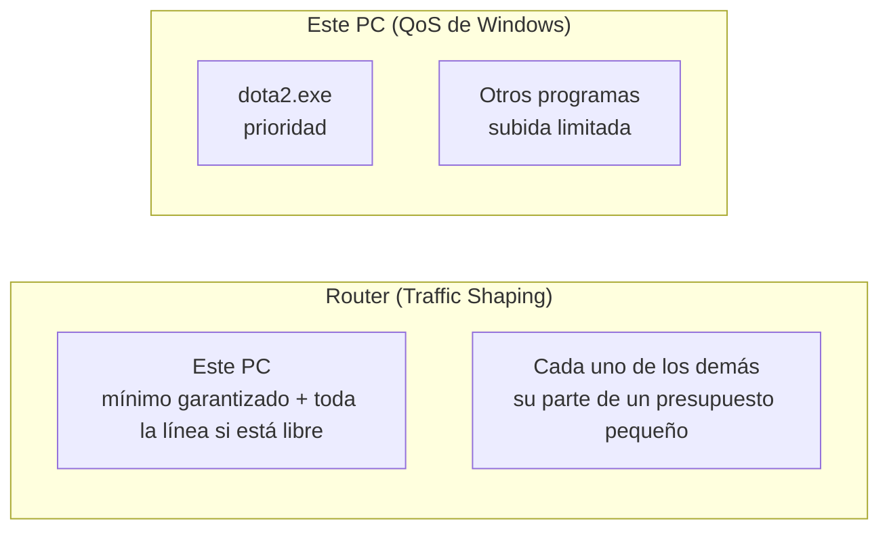

<div align="center">

# RedFilter

**Menos lag en una conexión lenta.**
Prioriza tu juego en este PC y reparte la red de tu casa desde el router, en una sola ventana.

[](https://github.com/BuddhaCodes/RedFilter/actions/workflows/build.yml)
&nbsp;
[**Descargar la última versión**](https://github.com/BuddhaCodes/RedFilter/releases/tag/latest)

Windows 10/11 · .NET 10 · Avalonia 12 · tema oscuro

</div>

---

## ¿Qué hace?

| Función | En una frase |
|---|---|
| **Modo Dota 2** | Un botón: reserva la línea para este PC, frena a todos los demás dispositivos de la casa y deja internet en este PC solo a Dota. |
| **Mi Wi-Fi** | Muestra quién está usando la red ahora mismo, y te deja **limitar** o **bloquear** a cualquier dispositivo. |
| **Este PC** | Da prioridad a un programa de este ordenador y limita la subida de los demás. |

Pensado para líneas ADSL pequeñas (unos 4 Mbps de bajada y 1 Mbps de subida), donde un solo vídeo en otro móvil basta para subir el ping.

> RedFilter solo habla con este PC y con tu router. No escanea la red, no adivina contraseñas y no envía tramas Wi-Fi.

## Descargar y usar

1. Ve a [**Releases → Última compilación**](https://github.com/BuddhaCodes/RedFilter/releases/tag/latest) y descarga `RedFilter-…-win-x64.exe`.
2. Ejecútalo. Es un solo archivo y no necesita instalar .NET.
3. En **Mi Wi-Fi** escribe la contraseña del router. La dirección y el usuario ya vienen puestos.

> **SmartScreen:** el ejecutable no está firmado, así que Windows puede avisar la primera vez. Pulsa *Más información* → *Ejecutar de todas formas*.

**Router compatible:** TP-Link **TD-W8961N v5** (firmware Realtek, panel en `http://192.168.1.1`). La parte de *Este PC* funciona con cualquier router.

## Modo Dota 2

Pulsa el botón redondo del panel de arriba. Para apagarlo, vuelve a pulsarlo; todo queda como estaba.



### Niveles

Se elige en el panel y se puede cambiar con el modo encendido.

| Nivel | Todos los demás juntos (bajada / subida) | Otros programas de este PC | Les alcanza para |
|---|---|---|---|
| Suave | hasta 2,5 Mbps / 384 kbps · 65 % / 40 % | 256 kbps | vídeo en calidad media |
| **Agresivo** *(por defecto)* | hasta 1 Mbps / 160 kbps · 25 % / 15 % | 128 kbps | chat, web, vídeo en baja calidad |
| Extremo | hasta 384 kbps / 64 kbps · 10 % / 6 % | 64 kbps | solo mensajes y notificaciones |

Cada nivel usa la menor de las dos cifras (la fija o el porcentaje), así que en una línea lenta también aprieta. Con seis dispositivos en casa, en Agresivo a cada uno le tocan unos 163 kbps de bajada y 22 kbps de subida.

### Solo Dota tiene internet en este PC

Con la casilla **"En este PC, solo Dota tiene internet"** (marcada por defecto), mientras el modo está encendido y Dota abierto, los demás programas de este PC se quedan **sin internet**: navegador, descargas, actualizadores…

- Usa reglas de **Windows Firewall** (grupo `RedFilter`) que bloquean la salida de cada programa que use la red. Los que se abran a mitad de partida también se bloquean.
- **Siguen con internet:** Windows (DNS, servicios), la carpeta de Dota, **Steam** (Dota lo necesita para entrar y buscar partida) y RedFilter. **Discord** también, si marcas *Dejar internet a Discord (voz)*.
- **Se quita sola:** al cerrar Dota, al apagar el modo o al cerrar RedFilter, todos los programas recuperan internet.
- Las conexiones que un programa ya tenía abiertas pueden aguantar unos segundos; las nuevas se bloquean al momento.
- Si la casilla está desmarcada, los demás programas siguen con internet, pero con la subida limitada según el nivel.

<details>
<summary>Si un programa se quedó sin internet (por ejemplo, tras un apagón)</summary>

Las reglas del firewall sobreviven a un reinicio. RedFilter las quita al abrirse como administrador si el modo ya no está activo. También puedes quitarlas a mano desde un PowerShell como administrador:

```powershell
Remove-NetFirewallRule -Group RedFilter
```
</details>

### Detalles

- **Automático:** si la casilla está marcada, la app te ofrece el modo cuando detecta Dota 2 y lo apaga sola 20 segundos después de que cierres el juego.
- **Nuevos dispositivos:** si alguien se conecta durante la partida, recibe su regla en menos de un minuto.
- **Tus límites se respetan:** si ya tenías a alguien limitado por debajo de lo que le toca, se queda con tu límite.
- **Deshacer seguro:** antes de tocar el router, la app guarda cómo estaba. Al apagar el modo lo deja igual, aunque la app se haya cerrado entre medias.
- **En este PC** (prioridad y firewall) hace falta permiso de administrador. Si RedFilter no lo tiene, Windows lo pide y la app se reinicia.

<details>
<summary><b>¿Por qué funciona? (y por qué frena sobre todo la subida)</b></summary>

Dota 2 usa muy poco ancho de banda, menos de 100 kbps. Lo que sube el ping es que otro dispositivo llene la línea, y sobre todo la **subida**, que en ADSL es muy pequeña: los paquetes del juego quedan esperando detrás en la cola del módem.

Por eso el router reparte la línea un poco por debajo de lo que sincroniza el ADSL (85 % de bajada y 80 % de subida). En ADSL llega menos de lo que dice la sincronización, y si el router reparte por encima de eso, la cola del módem se llena igual.

Este PC tiene garantizado lo que los demás no pueden usar, nunca menos de la mitad de la línea, y puede usarla entera cuando está libre. Cada regla cubre una sola IP y ninguna se solapa con otra, así que el resultado no depende de cómo ordene el router sus reglas.
</details>

## Mi Wi-Fi

La lista muestra los dispositivos conectados, con el que más usa la red arriba:

- **Uso ahora:** alto, medio o bajo, comparado con el que más usa. El número exacto aparece al pasar el ratón.
- **Estado:** Normal, Bloqueado, Limitado o Modo Dota.
- **Acciones:** cada fila muestra un botón para deshacer (*Desbloquear* o *Quitar límite*). Lo demás está en el menú **⋯**.

### Limitar

Pone un tope de velocidad sin echar al dispositivo: **64, 128, 256 o 512 kbps, o 1 Mbps** de bajada, y un cuarto de eso de subida.

<details>
<summary>Cómo lo hace en el router</summary>

- Usa *Advanced → IP QoS → Traffic Shaping* (`ipqostc.htm`), que limita por IP.
- Primero fija la IP actual del dispositivo en *DHCP Static IP* (`dhcpip.htm`), para que el límite no se pierda si el router le da otra. Si el dispositivo ya tenía otra IP fija, te pide que lo reconectes antes.
- Si la línea está en "sin límite", le pone el 85 % de bajada y el 80 % de subida de la sincronización ADSL.
- Crea una regla que solo mira la IP de origen y vuelve a leer la página para confirmar que quedó guardada.
- *Quitar límite* borra la regla. Si no queda ninguna, la línea vuelve a "sin límite". La IP fija se queda, porque no molesta.
- No toca las reglas que hayas creado tú con más condiciones (protocolo, puertos, rangos).
</details>

### Bloquear

Echa al dispositivo del Wi-Fi y no le deja volver a entrar hasta que lo desbloquees.

<details>
<summary>Salvaguardas y cómo lo hace</summary>

- Usa la *Access Control List* del Wi-Fi en modo "Deny Listed", y después de cada cambio vuelve a leer la página para confirmarlo.
- **Nunca bloquea este PC.** Si este PC está en la lista, lo saca antes de encender el bloqueo.
- Avisa antes de bloquear un **repetidor**, porque dejaría sin Wi-Fi a todo lo que cuelga de él.
- Si la lista del router tiene dispositivos guardados con el bloqueo apagado, la app lo avisa una vez y ofrece **Limpiar lista**.
- No toca el modo "Allow Listed", que dejaría fuera a todos los demás.
</details>

### Límites de lo que se puede hacer

- El **bloqueo** es por MAC y solo para el Wi-Fi. No afecta a lo conectado por cable, y un móvil con "dirección MAC privada" puede volver a entrar si cambia de MAC.
- Lo que se conecta a través de un **repetidor** (por ejemplo un RE1500X) el router lo ve como un solo dispositivo: el repetidor.
- El router no da bytes por dispositivo, solo paquetes. Por eso el uso se muestra comparado con el que más usa.

## Este PC

La lista muestra los programas que usan la red. **Priorizar** usa las directivas QoS de Windows:

- Marca el tráfico de ese programa con DSCP 46.
- Limita la **subida** de los demás programas a 256 kbps, 1 Mbps o 5 Mbps. Las descargas no se limitan.
- No limita los procesos de Windows (svchost y similares). Windows Update va dentro de svchost; para frenarlo usa *Configuración → Windows Update → Opciones avanzadas → Optimización de distribución*.
- Con RedFilter abierto, los programas que empiecen a usar la red también se limitan solos.
- Las directivas siguen activas aunque cierres la app, hasta que pulses **Quitar prioridad** o reinicies Windows.

## Problemas comunes

<details>
<summary><b>"No llego al router" con una VPN encendida</b></summary>

Si una VPN como WireGuard manda todo por el túnel, el PC no llega a `192.168.1.1`. En WireGuard, quita *Block untunneled traffic (kill-switch)* o excluye `192.168.1.0/24` de *AllowedIPs*. Con la VPN encendida, la prioridad dentro de este PC también puede no notarse, porque todo sale cifrado por el túnel.
</details>

<details>
<summary><b>La app se desconecta del router</b></summary>

El TD-W8961N acepta un solo administrador a la vez. Si entras al panel del router desde el navegador, RedFilter pierde la sesión, y al revés. La app vuelve a entrar sola una vez cuando la sesión caduca.
</details>

<details>
<summary><b>Quiero cambiar de router, de usuario o de contraseña</b></summary>

Abajo en *Mi Wi-Fi*, pulsa **Olvidar la contraseña / cambiar de router**. Aparecen la dirección, el usuario y la contraseña para cambiarlos.
</details>

<details>
<summary><b>El modo Dota 2 no baja el ping</b></summary>

Prueba con el nivel **Extremo**. Si aun así no mejora, puede que haga falta encender *IP QoS* en el router (*Advanced → IP QoS*). Abre un issue con lo que veas.
</details>

## Privacidad y seguridad

- La contraseña del router solo se guarda si lo pides, cifrada con **DPAPI** para tu usuario de Windows, en `%LOCALAPPDATA%\RedFilter`. La dirección y el usuario se guardan sin cifrar, porque no son secretos.
- El inicio de sesión envía lo mismo que la página del router: `md5(usuario)` y `md5(contraseña)`.
- Antes de enviar la contraseña, la app comprueba que la dirección responde con la página de inicio de sesión de un TD-W8961N.
- El PowerShell elevado ejecuta siempre un script fijo (`-EncodedCommand`), uno para QoS y otro para el firewall. Los bloqueos del firewall llevan el grupo `RedFilter` y nunca afectan a procesos de Windows ni a RedFilter. Rutas, nombres y límites entran como JSON solo ASCII por la entrada estándar y nunca se interpretan como código. No se escribe nada en `%TEMP%`.

## Para desarrolladores

Necesitas Windows 10/11 de 64 bits y el [.NET 10 SDK](https://dotnet.microsoft.com/download).

```bat
dotnet run --project src\RedFilter.App
dotnet test -c Release
```

```text
src/
  RedFilter.Core/     Lógica sin dependencias de Windows: clientes del router, modo Dota 2, QoS, ajustes
    Router/TpLink/    TD-W8961N: páginas, sesión, límites (Traffic Shaping), modo Dota 2
  RedFilter.App/      Interfaz Avalonia (MVVM) y piezas de Windows (QoS por PowerShell, DPAPI, procesos)
tests/
  RedFilter.Core.Tests/   xUnit, con HTML capturado de un router real
```

El núcleo también tiene clientes para **OpenWrt** (ubus), **ASUSWRT** y **FRITZ!Box** (TR-064), con pruebas, aunque la ventana actual solo usa el del TD-W8961N.

### Compilación y versiones (GitHub Actions)

[`.github/workflows/build.yml`](.github/workflows/build.yml) corre los tests y publica un `RedFilter.exe` autocontenido de un solo archivo:

| Cuándo | Qué publica |
|---|---|
| Cada push a `main` | Reemplaza el pre-release [**latest**](https://github.com/BuddhaCodes/RedFilter/releases/tag/latest) |
| Una etiqueta `v1.2.3` | Una versión permanente en *Releases* |
| Cada ejecución | El artefacto `RedFilter-win-x64` en la pestaña *Actions* |

```bat
git tag v1.1.0
git push origin v1.1.0
```
